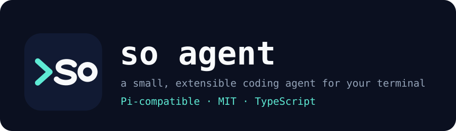

<p align="center">
  
</p>

<p align="center">
  <a href="https://github.com/kevin9327/so-agent/actions/workflows/ci.yml"></a>
  <a href="https://github.com/kevin9327/so-agent/releases"></a>
  <a href="LICENSE"></a>
  = 22.19" src="https://img.shields.io/badge/node-%3E%3D22.19-339933?style=flat-square&logo=node.js&logoColor=white" />
  
</p>

**so agent** is a terminal coding agent: a minimal harness with `read`, `write`, `edit` and `bash` tools that you extend with TypeScript extensions, skills, prompt templates, themes and packages instead of waiting for features. It is a **fork of [Pi](https://github.com/earendil-works/pi)** (MIT, by Mario Zechner and contributors; [ATTRIBUTION.md](ATTRIBUTION.md)), renamed, kept compatible with Pi's extension API, and tuned conservatively. Early (0.0.x), built from source for now.

A real run (so 0.0.2, local Qwen3-4B model, [full transcript and how it was recorded](docs/demo.md)):

```text
You: Change the default server port from 3000 to 8080 in config.js and update the README so it states the new default. Change nothing else.

  read   config.js
  read   README.md
  edit   config.js     Successfully replaced 1 block(s) in config.js.
  edit   README.md     Successfully replaced 1 block(s) in README.md.

so: I've updated both files as requested: the default port in config.js is now 8080 and the README states it.
```

## Why so agent

so is the same agent as Pi 1.4.0 with its behavior kept (nothing removed), plus a short list of changes that are measured or tested. The numbers are in [docs/EFFICIENCY.md](docs/EFFICIENCY.md); they are small on purpose, because most of an agent's time is the model, not the harness.

| | Pi 1.4.0 | so 0.0.3 | How measured |
|---|---|---|---|
| `so --version` | 171.5 ms | **23.5 ms** | median of 31 runs (`bench/run.mjs`); `node -e 0` alone is 20.7 ms |
| Peak memory, one print-mode run | 122 MiB | **117 MiB** | same harness |
| Time to first provider request | 234 ms | 235 ms (same) | same harness, mock provider |
| System prompt, tool descriptions | upstream | upstream wording | unchanged apart from the name |
| Prompt cache prefix across turns | stable | stable | `promptPrefixBreak: null` |

What else is different:

- **Pi extensions keep working.** `@earendil-works/pi-*` and `@mariozechner/pi-*` imports still resolve, next to the new `@so-agent/*` names.
- **Fork-safe network defaults.** Update check points at this package's npm entry, install reporting and the installer hint have no upstream endpoint, and the remote model catalog can be pointed elsewhere or off (`SO_CATALOG_URL`). Every variable is in [docs/UPSTREAM-ENDPOINTS.md](docs/UPSTREAM-ENDPOINTS.md).
- **Small fixes found by running it** (see [CHANGELOG](packages/coding-agent/CHANGELOG.md)): streams that send a tool call's arguments under a new index no longer create a nameless call; a failed `edit` shows the closest lines of the file; the output-limit error tells the model how to retry.
- **A reproducible rename** from upstream: `rename/rename.sh` regenerates this tree from a Pi checkout, so upstream updates can be merged.
- **A real-model eval harness** for comparing builds on the same tasks with any OpenAI-compatible endpoint ([bench/eval](bench/eval/README.md)). The first small eval, on a local 4B model, found no difference between so and Pi beyond noise; the sample is tiny and it is documented as such.

What so is **not**: it is not faster in the work that matters (model latency), it has no new features over Pi yet, and it is not affiliated with the Pi authors. If you only want the original, use [Pi](https://github.com/earendil-works/pi).

## Quick start (from source)

so is not on npm yet. Requires Node.js 22.19 or newer.

```bash
git clone https://github.com/kevin9327/so-agent && cd so-agent
npm ci --ignore-scripts
npm run build                     # builds all packages (refreshes model data from the network)

# run it from any project directory
cd /path/to/your/project
node /path/to/so-agent/packages/coding-agent/dist/bundle/cli.js
# optional: alias so="node /path/to/so-agent/packages/coding-agent/dist/bundle/cli.js"
```

Inside so, run `/login` to connect a subscription or API key, or export a provider key such as `ANTHROPIC_API_KEY` or `OPENAI_API_KEY`, then give it a task. A local model works too: add an OpenAI-compatible server to `~/.so/agent/models.json` (see [docs/models.md](packages/coding-agent/docs/models.md)). To run from TypeScript sources without building, use `./so-test.sh`.

`npm install -g @so-agent/coding-agent` will work once the packages are published; until then that command fails.

## What you can do with it

Customize so with [extensions](packages/coding-agent/docs/extensions.md), [skills](packages/coding-agent/docs/skills.md), [prompt templates](packages/coding-agent/docs/prompt-templates.md), and [themes](packages/coding-agent/docs/themes.md). Bundle them as [packages](packages/coding-agent/docs/packages.md) and share via npm or git. Use so [interactively](packages/coding-agent/docs/usage.md), automate it in [print or JSON mode](packages/coding-agent/docs/cli.md), control it over [RPC](packages/coding-agent/docs/rpc.md), or build apps with the [TypeScript SDK](packages/coding-agent/docs/sdk.md). It skips sub-agents and plan mode on purpose: ask so to build what you want, or install a package.

## Packages

This monorepo contains the So CLI and its supporting libraries.

| Package | Description |
|---------|-------------|
| **[@so-agent/chord](packages/chord)** | Typed host runtime for hot-reloadable plugins, contracts, replicated state, and RPC over JSON links |
| **[@so-agent/telemetry](packages/telemetry)** | Vendor-neutral telemetry contracts, reference adapter, conformance tests, and typed schemas |
| **[@so-agent/ai](packages/ai)** | Unified multi-provider LLM API (OpenAI, Anthropic, Google, etc.) |
| **[@so-agent/durable](packages/durable)** | Durable conversation, task, and document runtime |
| **[@so-agent/agent-core](packages/agent)** | Agent runtime with tool calling and state management |
| **[@so-agent/coding-agent](packages/coding-agent)** | Interactive coding agent CLI |
| **[@so-agent/tui](packages/tui)** | Terminal UI library with differential rendering |

For Slack/chat automation and workflows see upstream's [pi-chat](https://github.com/earendil-works/pi-chat) (a Pi project, not tested with so).

## Permissions & Containerization

So does not include a built-in permission system for restricting filesystem, process, network, or credential access. By default, it runs with the permissions of the user and process that launched it.

If you need stronger boundaries, containerize or sandbox So. See [packages/coding-agent/docs/containerization.md](packages/coding-agent/docs/containerization.md) for three patterns:

- **Gondolin extension**: keep `so` and provider auth on the host while routing built-in tools and `!` commands into a local Linux micro-VM.
- **Plain Docker**: run the whole `so` process in a local container for simple isolation.
- **OpenShell**: run the whole `so` process in a policy-controlled sandbox.

## Contributing

Issues and PRs are welcome (no contribution gate on this fork). See [CONTRIBUTING.md](CONTRIBUTING.md) for contribution guidelines and [AGENTS.md](AGENTS.md) for project-specific rules (for both humans and agents).  Upstream's longer-term plans for Pi are in its [RFCs](https://rfc.earendil.com/keyword/pi/).

## Development

```bash
npm install --ignore-scripts  # Install all dependencies without running lifecycle scripts
npm run build         # Refresh model data, then build all packages
npm run build:offline # Rebuild using existing model data without network access
npm run check         # Lint, format, and type check
./test.sh            # Run tests (skips LLM-dependent tests without API keys)
./so-test.sh         # Run so from sources (can be run from any directory)
```

### Using local packages outside the monorepo

Build every public package into one coherent local artifact set:

```bash
npm run pack:packages -- --out .artifacts/so-packages
```

This refreshes model data before building `so-ai`. To avoid network access when
model data is already hydrated, pass `--offline-model-data`.

Then configure an external project to consume one package and resolve all of
its So dependencies from the same artifact set. npm is the default:

```bash
node scripts/use-local-packages.mjs \
  --manifest .artifacts/so-packages/manifest.json \
  --consumer ../my-project \
  --package @so-agent/durable \
  --package @so-agent/agent-core
cd ../my-project
npm install --ignore-scripts
```

For a pnpm project, point `--consumer` at the workspace root:

```bash
node scripts/use-local-packages.mjs \
  --manifest .artifacts/so-packages/manifest.json \
  --consumer ../my-project \
  --package @so-agent/agent-core \
  --package-manager pnpm
cd ../my-project
pnpm install --ignore-scripts
```

Repeat `--package` for each direct dependency. The command updates the
consumer's `package.json` with content-addressed local `file:` references. It
writes transitive overrides to `package.json` for npm or `pnpm-workspace.yaml`
for pnpm. Keep the artifact directory available while installing or updating
the consumer. Re-run both commands after changing So source.

## Building standalone binaries from release source

GitHub releases include a versioned source archive covered by the release's `SHA256SUMS` file. Extract it and run the same build script used for the official standalone binaries:

```bash
VERSION="<release-version>"
tar -xzf "so-${VERSION}-source.tar.gz"
cd "so-${VERSION}"
./scripts/build-binaries.sh --offline-model-data --platform linux-x64 --out "$PWD/out"
```

The archive includes release model data and native prebuilds. `--offline-model-data` uses that model data without refreshing provider catalogs. The script installs dependencies and builds the executable with its runtime assets; pass `--skip-install` if dependencies are already provided.

## Supply-chain hardening

We treat npm dependency changes as reviewed code changes.

- Direct external dependencies are pinned to exact versions. Internal workspace packages remain version-ranged.
- `.npmrc` sets `save-exact=true` and `min-release-age=2` to avoid same-day dependency releases during npm resolution.
- `package-lock.json` is the dependency ground truth. Pre-commit blocks accidental lockfile commits unless `SO_ALLOW_LOCKFILE_CHANGE=1` is set.
- `npm run check` verifies pinned direct deps, native TypeScript import compatibility, and the generated coding-agent install lock.
- The upstream (Pi) installer installs from `packages/coding-agent/install-lock/`, generated from the root lockfile, to pin transitive deps. The npm package does not pin transitive deps.
- Local release smoke tests and npm publication use the same tarball packer; npm publishes the validated tarballs rather than repacking workspace directories.
- Local release installs, documented npm installs, and `so update --self` use `--ignore-scripts` where supported.
- CI installs with `npm ci --ignore-scripts`, and a scheduled GitHub workflow runs `npm audit --omit=dev` plus `npm audit signatures --omit=dev`.
- Install lock generation has an explicit allowlist for dependency lifecycle scripts; new lifecycle-script deps fail checks until reviewed.

## Launch notes, comparison, history

- [docs/EFFICIENCY.md](docs/EFFICIENCY.md): every change from the first pass, what was kept, restored or replaced, and measured numbers
- [docs/VERSIONING.md](docs/VERSIONING.md), [CHANGELOG](packages/coding-agent/CHANGELOG.md), [releases](https://github.com/kevin9327/so-agent/releases)
- [docs/UPSTREAM-ENDPOINTS.md](docs/UPSTREAM-ENDPOINTS.md), [docs/INSTALL-REPORT.md](docs/INSTALL-REPORT.md)
- [docs/UPSTREAM-README-SECTIONS.md](docs/UPSTREAM-README-SECTIONS.md): sections of upstream's README that do not apply here

## License

MIT. The original license and copyright notice (Mario Zechner) are kept; see [LICENSE](LICENSE) and [ATTRIBUTION.md](ATTRIBUTION.md).
